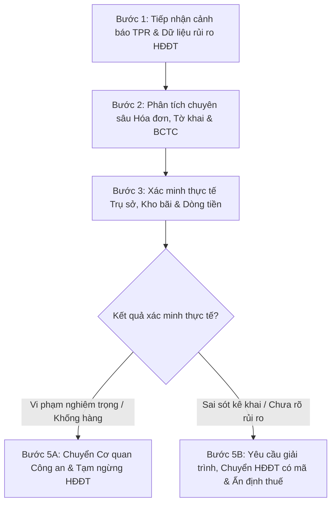

# Quản lý rủi ro thuế và hóa đơn điện tử

Cẩm nang nghiệp vụ chuyên sâu và quy chuẩn thực thi phục vụ toàn diện công tác phân tích, nhận diện, cảnh báo, kiểm tra và xử lý người nộp thuế (NNT) có rủi ro cao về thuế và hóa đơn điện tử; tích hợp toàn diện khung tiêu chí mới nhất từ **Quyết định số 1264/QĐ-CT ngày 04/09/2026** của Cục Thuế, **Công văn số 1125/CT-QLTT ngày 13/02/2026** về siết chặt xử lý cảnh báo rủi ro hóa đơn, **Công văn số 1873/TCT-TTKT ngày 01/06/2022** kèm Phụ lục 25 dấu hiệu hành vi vi phạm hóa đơn và **Công văn số 2383/TCT-TTKT ngày 23/06/2021** về giám sát, xử lý doanh nghiệp mua bán hóa đơn bất hợp pháp.

## Khi nào sử dụng skill

- Khi tiếp nhận danh sách NNT cảnh báo rủi ro tự động từ Hệ thống quản lý rủi ro (TPR) và Ứng dụng quản lý HĐĐT (cảnh báo vượt hệ số K, cảnh báo theo 9 tiêu chí rủi ro hóa đơn).
- Khi phân tích, đối chiếu số lượng và giá trị hóa đơn điện tử xuất bán với tờ khai thuế GTGT, kiểm tra hóa đơn giá trị lớn và dòng tiền thanh toán qua ngân hàng.
- Khi rà soát các dấu hiệu doanh nghiệp thành lập để mua bán hóa đơn khống: vốn điều lệ thấp nhưng doanh thu đột biến, không có kho hàng, không có tài sản cố định, một cá nhân đứng tên nhiều doanh nghiệp.
- Khi thẩm định tính hợp lý của hóa đơn đầu vào: người bán bỏ trốn/tạm ngừng hoạt động, mua nguyên vật liệu cách xa địa bàn kinh doanh không có vùng nguyên liệu.
- Khi xử lý hồ sơ hoàn thuế GTGT có hóa đơn đầu vào từ doanh nghiệp rủi ro cao: hướng dẫn kê khai điều chỉnh, lập cam kết pháp lý hoặc yêu cầu xác minh liên tỉnh.
- Khi áp dụng các biện pháp ngăn chặn kịp thời: yêu cầu giải trình, chuyển hình thức HĐĐT không mã sang có mã của cơ quan thuế, tạm ngừng sử dụng HĐĐT hoặc hoàn thiện hồ sơ chuyển Cơ quan Cảnh sát điều tra.

---

## 1. Hệ thống căn cứ pháp lý và văn bản chỉ đạo rủi ro cốt lõi

| Văn bản | Ngày ban hành | Cơ quan ban hành | Vai trò và nội dung điều chỉnh trọng tâm |
| :--- | :--- | :--- | :--- |
| **Quyết định 1264/QĐ-CT** | 04/09/2026 | Cục trưởng Cục Thuế | Ban hành Bộ chỉ số tiêu chí xác định NNT có rủi ro cao về thuế và HĐĐT (Giai đoạn 1): 4 chỉ số tiêu chí tính điểm tự động, ngưỡng hệ số K và tỷ lệ doanh thu/vốn. |
| **Công văn 1125/CT-QLTT** | 13/02/2026 | Cục Thuế (Ban QLTT) | Công văn HỎA TỐC chỉ đạo siết chặt xử lý cảnh báo rủi ro hóa đơn; cấm dừng cảnh báo khi chưa xác minh thực tế; quy định 8 nội dung kiểm tra bắt buộc. |
| **Công văn 1873/TCT-TTKT** | 01/06/2022 | Tổng cục Thuế | Chỉ đạo tăng cường rà soát, kiểm tra phát hiện NNT có rủi ro về hóa đơn, chống gian lận hoàn thuế; ban hành Phụ lục 25 dấu hiệu hành vi vi phạm. |
| **Công văn 2383/TCT-TTKT** | 23/06/2021 | Tổng cục Thuế | Chấn chỉnh công tác phát hiện NNT rủi ro về hóa đơn sau vụ án 13 doanh nghiệp tại Thanh Hóa; công khai doanh nghiệp bỏ trốn, xử lý kỷ luật cán bộ. |
| **Thông tư 94/2026/TT-BTC** | 01/07/2026 | Bộ Tài chính | Quy định về quản lý tuân thủ, quản lý rủi ro trong quản lý thuế theo Luật Quản lý thuế số 108/2025/QH15. |
| **Thông tư 91/2026/TT-BTC** | 30/06/2026 | Bộ Tài chính | Hướng dẫn thi hành Nghị định số 254/2026/NĐ-CP về hóa đơn, chứng từ điện tử; tiêu chuẩn xử lý rủi ro và ngừng sử dụng HĐĐT. |
| **TTLT 85/2016/TTLT-BTC-BCA** | 20/06/2016 | Bộ Tài chính - Bộ Công an | Quy chế phối hợp liên ngành xác minh nguồn gốc hàng hóa, chuyển hồ sơ vụ án có dấu hiệu tội phạm trốn thuế, mua bán hóa đơn sang Công an. |
| **Quyết định 1796/QĐ-BTC** | 11/09/2017 | Bộ Tài chính | Sửa đổi Quy chế xử lý thông tin tổ chức, cá nhân có giao dịch đáng ngờ qua ngân hàng tại cơ quan thuế các cấp. |
| **Quyết định 2413/QĐ-BTC** | 23/11/2017 | Bộ Tài chính | Quy chế trao đổi thông tin giữa cơ quan Hải quan và cơ quan Thuế về tờ khai xuất nhập khẩu, kiểm tra đột xuất lô hàng hoàn thuế. |
| **Quyết định 1036/QĐ-TCT** | 11/06/2013 | Tổng cục Thuế | Quy định 10 điều kỷ luật đối với công chức, viên chức ngành thuế; chế tài xử lý buông lỏng quản lý, tiếp tay cho gian lận hóa đơn. |

---

## 2. Bộ chỉ số tiêu chí xác định NNT có rủi ro cao về thuế và HĐĐT (QĐ 1264/QĐ-CT)

Theo Quyết định số 1264/QĐ-CT ngày 04/09/2026, Cục Thuế ban hành Bộ chỉ số tiêu chí xác định người nộp thuế có rủi ro cao về thuế và hóa đơn điện tử (Giai đoạn 1), áp dụng tự động trên hệ thống dữ liệu toàn ngành:

### 2.1. Bảng danh mục 4 chỉ số tiêu chí rủi ro trọng điểm (Giai đoạn 1)

| STT | Tiêu chí rủi ro | Chỉ số tiêu chí chi tiết | Điểm số | Ngưỡng và điều kiện xác định rủi ro |
| :---: | :--- | :--- | :---: | :--- |
| **1** | Xuất hóa đơn vượt ngưỡng an toàn | NNT xuất HĐĐT có giá trị lũy kế trong kỳ tính thuế vượt ngưỡng rủi ro theo ngành nghề kinh doanh chính. | **5** | Hệ số K vượt ngưỡng rủi ro, kết hợp với điều kiện về doanh thu theo tham số áp dụng tại thời điểm phân tích. |
| **2** | Xuất hóa đơn có dấu hiệu bất thường | NNT có một trong các giá trị xác định hệ số cảnh báo xuất HĐĐT vượt ngưỡng rủi ro có dấu hiệu bất thường. | **5** | Giá trị hàng hóa, dịch vụ (HHDV) bán ra dương trong khi tổng giá trị tồn kho, lũy kế HHDV mua vào, nhập khẩu bằng 0 hoặc thấp bất thường so với giá trị bán ra. |
| **3** | Biến động doanh thu bán hàng hóa, dịch vụ | NNT có doanh thu HHDV bán ra lũy kế trên HĐĐT trong tháng đến thời điểm phân tích vượt ngưỡng. | **5** | So sánh với lịch sử hoạt động của chính NNT và/hoặc nhóm NNT có đặc điểm tương đồng trong cùng ngành nghề, địa bàn. |
| **4** | Tỷ lệ doanh thu trên vốn điều lệ bất thường | NNT thành lập dưới 12 tháng và có tỷ lệ doanh thu HHDV bán ra lũy kế trên vốn điều lệ vượt ngưỡng. | **5** | Tỷ lệ doanh thu/vốn điều lệ vượt ngưỡng rủi ro áp dụng tại thời điểm phân tích (vốn mỏng nhưng doanh số xuất hóa đơn đột biến). |

### 2.2. Quy trình sàng lọc và xử lý danh sách NNT rủi ro cao
- **Bước sàng lọc tự động**: Hệ thống CNTT tự động quét toàn bộ cơ sở dữ liệu hóa đơn và tờ khai, tính tổng hợp điểm số rủi ro của từng NNT.
- **Phân nhóm xử lý**: Căn cứ kết quả sàng lọc, trạng thái hoạt động và ngành nghề, Cục Thuế ban hành danh sách rà soát theo từng đợt triển khai.
- **Loại trừ hoặc bổ sung**: Trưởng đơn vị quản lý thuế trực tiếp xem xét đặc điểm thực tế hoạt động để loại trừ các trường hợp đặc thù (mùa vụ, dự án lớn giải ngân một lần) hoặc bổ sung các NNT có thông tin cảnh báo ngoài hệ thống.
- **Biện pháp xử lý nghiệp vụ theo kết quả đánh giá (Mục 8 QĐ 1264)**:
  + Gửi thông báo yêu cầu NNT giải trình, cung cấp tài liệu chứng minh tính hợp pháp của hóa đơn;
  + Chuyển đổi hình thức sử dụng HĐĐT từ không có mã sang có mã của cơ quan thuế;
  + Tạm ngừng sử dụng HĐĐT theo quy định tại Thông tư số 91/2026/TT-BTC;
  + Đưa vào kế hoạch kiểm tra đột xuất hoặc chuyển hồ sơ sang Cơ quan điều tra.

---

## 3. Quy chuẩn siết chặt xử lý cảnh báo rủi ro hóa đơn (Công văn 1125/CT-QLTT)

Công văn số 1125/CT-QLTT ngày 13/02/2026 của Cục Thuế ban hành lệnh HỎA TỐC chấn chỉnh kỷ cương nghiệp vụ kiểm tra rủi ro hóa đơn:

### 3.1. Các nguyên tắc cấm tuyệt đối đối với công chức kiểm tra
- **Tuyệt đối không dừng cảnh báo rủi ro** khi chưa kiểm tra, xác minh đầy đủ hồ sơ và thực tế hoạt động của doanh nghiệp tại trụ sở.
- **Không chấp nhận việc chỉ căn cứ vào văn bản giải trình** của người nộp thuế để vội vã kết luận doanh nghiệp không có rủi ro.
- Nghiêm cấm mọi hành vi xử lý cảnh báo mang tính hình thức, buông lỏng quản lý hoặc tiếp tay cho đối tượng mua bán hóa đơn. Người đứng đầu đơn vị chịu trách nhiệm trực tiếp, toàn diện nếu để xảy ra sai phạm.

### 3.2. 8 nội dung kiểm tra trọng điểm bắt buộc khi xử lý danh sách cảnh báo
1. **Đối chiếu số lượng và giá trị HĐĐT**: So soát chặt chẽ giữa số lượng, giá trị trên HĐĐT đã xuất với số liệu kê khai trên Bảng kê và Tờ khai thuế GTGT.
2. **Kiểm tra hợp đồng và dòng tiền hóa đơn lớn**: Với các hóa đơn có giá trị đặc biệt lớn, bắt buộc kiểm tra đối chiếu hợp đồng kinh tế, biên bản giao nhận hàng hóa, chứng từ thanh toán ngân hàng và lịch sử dòng tiền thực tế.
3. **Rà soát khách hàng tập trung (mua bán lòng vòng)**: Doanh nghiệp có hoạt động bán hàng tập trung cho một số ít khách hàng lớn phải được đánh giá nguy cơ quan hệ mua bán lòng vòng, khống giá trị để hợp thức hóa hóa đơn.
4. **Kiểm tra tình trạng hoạt động của người bán đầu vào**: Tra cứu trên ứng dụng rủi ro để xác định người bán có thuộc diện rủi ro cao, tạm ngừng kinh doanh, hoặc bỏ trốn khỏi địa chỉ đăng ký hay không.
5. **Kiểm tra tính hợp lý của hàng hóa mua vào**: Đặc biệt lưu ý trường hợp mua nguyên vật liệu từ đơn vị không thuộc vùng nguyên liệu tự nhiên; hoặc mua hàng từ các đơn vị có khoảng cách địa lý rất xa nhưng không có chi nhánh, địa điểm kinh doanh tại địa bàn người mua.
6. **Phân tích sâu Báo cáo tài chính**: Phát hiện dấu hiệu bất thường: quy mô vốn nhỏ nhưng doanh thu đột biến; hoặc vốn kinh doanh thấp nhưng giá trị hàng tồn kho kê khai vượt gấp nhiều lần vốn.
7. **Rà soát doanh nghiệp mới thành lập**: 
   - Thành lập trong vòng 02 năm có giá trị mua vào lớn nhưng bán ra rất ít hoặc không bán ra;
   - Doanh nghiệp bán ra rất lớn nhưng không có đầu vào tương xứng;
   - Doanh nghiệp mới thành lập xuất số lượng hóa đơn rất lớn rồi thông báo tạm ngừng hoạt động nhưng vẫn tiếp tục phát sinh hóa đơn.
8. **Kiểm tra nhân sự đại diện và thay đổi địa điểm**: Một người đại diện pháp luật đứng tên nhiều doanh nghiệp; doanh nghiệp thay đổi địa điểm kinh doanh hoặc thay đổi trạng thái hoạt động nhiều lần trong năm.

---

## 4. Bảng 25 dấu hiệu hành vi vi phạm về hóa đơn (Phụ lục CV 1873/TCT-TTKT)

Phụ lục ban hành kèm Công văn số 1873/TCT-TTKT chuẩn hóa 25 dấu hiệu nhận diện NNT có hành vi vi phạm về quản lý, sử dụng hóa đơn bất hợp pháp:

| STT | Nhóm dấu hiệu | Nội dung hành vi vi phạm nhận diện chi tiết |
| :---: | :--- | :--- |
| **1** | Pháp nhân & Quản trị | Thay đổi người đại diện pháp luật từ **02 lần trở lên trong vòng 12 tháng** hoặc thay đổi đại diện đồng thời chuyển địa điểm kinh doanh. |
| **2** | Pháp nhân & Quản trị | Thay đổi trạng thái hoạt động hoặc ngành nghề kinh doanh từ **02 lần trong năm**. |
| **3** | Pháp nhân & Quản trị | Doanh nghiệp mới thành lập có địa điểm kinh doanh không cố định (chuyển địa điểm nhiều lần trong **1 - 2 năm** hoạt động). |
| **4** | Pháp nhân & Quản trị | Chuyển địa điểm hoạt động kinh doanh sau khi đã có Thông báo của cơ quan thuế về việc không hoạt động tại địa chỉ đã đăng ký. |
| **5** | Pháp nhân & Quản trị | Doanh nghiệp thành lập do các cá nhân có quan hệ gia đình cùng tham gia góp vốn (vợ, chồng, anh, chị em ruột...). |
| **6** | Pháp nhân & Quản trị | Doanh nghiệp mới thành lập do người đại diện pháp luật từng đứng tên công ty đã bị thông báo bỏ địa chỉ kinh doanh (còn nợ thuế) hoặc tạm ngừng hoạt động. |
| **7** | Pháp nhân & Quản trị | Doanh nghiệp thành lập nhiều năm không phát sinh doanh thu, sau đó bán lại, chuyển nhượng cho người khác rồi xuất hóa đơn lớn. |
| **8** | Pháp nhân & Quản trị | Một cá nhân đứng tên người đại diện theo pháp luật thành lập, điều hành nhiều doanh nghiệp. |
| **9** | Hoạt động & Vốn | Chưa góp đủ vốn điều lệ theo đăng ký kinh doanh khi đã hết thời hạn luật định. |
| **10** | Hoạt động & Vốn | Các doanh nghiệp thực hiện mua bán, sáp nhập với giá trị chuyển nhượng rất thấp (dưới **100 triệu đồng**). |
| **11** | Ngành nghề đặc thù | Doanh nghiệp không có giấy phép khai thác khoáng sản nhưng xuất hóa đơn bán tài nguyên, khoáng sản (cát, sỏi, đá, than...). |
| **12** | Ngành nghề đặc thù | Hàng hóa bán ra, mua vào không phù hợp với điều kiện tự nhiên, đặc điểm vùng miền. |
| **13** | Ngành nghề trọng điểm | Kinh doanh siêu thị bán lẻ, điện máy; nhà hàng, khách sạn; vận tải; vật liệu xây dựng; xăng dầu; khai thác đất đá; nông lâm sản dăm gỗ; cho thuê nhân công quy mô lớn. |
| **14** | Doanh thu & Thuế | Doanh thu tăng đột biến: kỳ trước xấp xỉ bằng 0 nhưng kỳ sau tăng gấp từ **03 lần trở lên** so với bình quân trước, nhưng thuế GTGT phải nộp **dưới 1% doanh số**. |
| **15** | Doanh thu & Thuế | Doanh thu kê khai hàng năm phát sinh trên **10 tỷ đồng** nhưng số thuế GTGT nộp ngân sách thấp dưới **100 triệu đồng (dưới 1%)**. |
| **16** | Doanh thu & Thuế | Doanh thu và thuế GTGT đầu ra, đầu vào rất lớn nhưng không phát sinh số thuế phải nộp, có số thuế GTGT âm liên tục nhiều kỳ. |
| **17** | Cơ cấu hàng hóa | Doanh nghiệp có giá trị hàng hóa bán ra, thuế GTGT đầu ra bằng hoặc chênh lệch rất nhỏ so với giá trị mua vào và thuế GTGT đầu vào. |
| **18** | Cơ cấu hàng hóa | Hàng hóa, dịch vụ bán ra hoàn toàn không phù hợp, không cùng chủng loại logic với hàng hóa, dịch vụ mua vào. |
| **19** | Cơ sở vật chất | Doanh thu rất lớn nhưng không có kho hàng, kho hàng không tương xứng hoặc không phát sinh chi phí thuê kho bãi. |
| **20** | Cơ sở vật chất | Không có tài sản cố định hoặc giá trị tài sản cố định rất thấp so với quy mô ngành nghề đăng ký. |
| **21** | Lao động | Sử dụng quy mô lao động không tương xứng với ngành nghề và sản lượng doanh thu kê khai. |
| **22** | Sử dụng hóa đơn | Sử dụng số lượng hóa đơn rất lớn (từ **500 đến 2.000 số**); số lượng hóa đơn xóa bỏ chiếm tỷ lệ cao (bình quân khoảng **20%** số hóa đơn sử dụng). |
| **23** | Sử dụng hóa đơn | Khi chuyển sang HĐĐT theo NĐ 123/NĐ 254 có số lượng hóa đơn sử dụng giảm sút bất thường so với thời kỳ dùng hóa đơn giấy theo NĐ 51. |
| **24** | Quản lý hóa đơn | Không nộp thông báo phát hành hóa đơn hoặc có thông báo nhưng không nộp báo cáo tình hình sử dụng hóa đơn (hoặc nộp chậm). |
| **25** | Dòng tiền ngân hàng | Phát sinh các giao dịch đáng ngờ qua tài khoản ngân hàng: tiền nộp vào và rút ra ngay trong ngày, luân chuyển tiền lòng vòng qua nhiều bên trung gian. |

---

## 5. Quy trình phối hợp liên ngành và thời hạn giải quyết xác minh hóa đơn

### 5.1. Thời hạn xác minh thông tin hóa đơn giữa các cơ quan thuế
- **Thời hạn chuẩn**: Chậm nhất **10 ngày làm việc** kể từ ngày nhận được phiếu yêu cầu xác minh hóa đơn, nguồn gốc hàng hóa, đơn vị được yêu cầu bắt buộc phải gửi văn bản trả lời kết quả.
- **Trường hợp phức tạp**: Thời hạn trả kết quả tối đa **không quá 30 ngày làm việc**.
- **Chế tài**: Nếu cơ quan thuế phối hợp không trả lời hoặc trả lời chậm trễ, Cục Thuế quản lý phải báo cáo ngay về Tổng cục Thuế (Cục Thuế) để có biện pháp chỉ đạo, xử lý trách nhiệm.
- **Đơn vị được yêu cầu xác minh**: Thông tin yêu cầu xác minh được xem là nguồn dữ liệu cảnh báo rủi ro cao để đưa ngay vào diện kiểm tra, giám sát trọng điểm.

### 5.2. Phối hợp Cơ quan Công an xử lý dấu hiệu hình sự (TTLT 85/2016/TTLT-BTC-BCA)
- Khi kiểm tra phát hiện hành vi xuất hóa đơn khống, mua bán hóa đơn nhằm trốn thuế hoặc chiếm đoạt tiền hoàn thuế: Trưởng đoàn kiểm tra báo cáo lãnh đạo hoàn thiện hồ sơ chuyển ngay Cơ quan Cảnh sát điều tra.
- Hồ sơ chuyển giao phải đảm bảo tính pháp lý, xác định rõ: thủ đoạn thành lập công ty "ma", người đứng tên danh nghĩa, các giao dịch ngân hàng chứng minh dòng tiền khống, và xác nhận bên bán không có hàng hóa thực tế.

### 5.3. Xử lý hóa đơn đầu vào nghi vấn trong kiểm tra hoàn thuế GTGT
- Khi phát hiện NNT có sử dụng hóa đơn đầu vào của doanh nghiệp có dấu hiệu mua bán hóa đơn nhưng **chưa có kết luận chính thức** của cơ quan chức năng:
  + Cơ quan thuế gửi thông báo bằng văn bản yêu cầu NNT giải trình và kê khai điều chỉnh giảm thuế GTGT đầu vào khấu trừ/hoàn thuế.
  + Trường hợp NNT vẫn khẳng định giao dịch có thật và đúng pháp luật: NNT bắt buộc phải lập **văn bản cam kết chịu hoàn toàn trách nhiệm trước pháp luật**.
  + Cơ quan thuế quản lý trực tiếp chủ động phối hợp với cơ quan thuế quản lý doanh nghiệp bán hàng để kiểm tra hồ sơ, trích xuất dữ liệu xác minh thực chất giao dịch.

---

## 6. Quy trình kiểm tra, xử lý NNT có rủi ro cao về hóa đơn (Checklist 5 bước)

### Bước 1: Tiếp nhận danh sách cảnh báo và thu thập dữ liệu đa chiều
- Tra cứu danh sách cảnh báo hệ số K, cảnh báo 9 tiêu chí trên Hệ thống quản lý rủi ro và ứng dụng HĐĐT.
- Thu thập dữ liệu liên thông: tình trạng đăng ký doanh nghiệp, số lần đổi người đại diện, số lần đổi địa điểm, thông tin giao dịch đáng ngờ từ ngân hàng, thông tin từ cơ quan Hải quan.

### Bước 2: Phân tích chuyên sâu đối chiếu trên hệ thống
- Lập bảng đối chiếu doanh thu trên HĐĐT xuất ra với doanh thu trên Tờ khai thuế GTGT và Tờ khai thuế TNDN.
- So sánh tỷ lệ giá trị mua vào / bán ra; kiểm tra tính hợp lý của danh mục hàng hóa (đầu vào mua cát đá, đầu ra bán sắt thép hoặc dịch vụ).
- Đánh giá chỉ số: Doanh thu / Vốn điều lệ; Doanh thu / Giá trị tài sản cố định; Doanh thu / Số lượng lao động; Doanh thu / Chi phí thuê kho bãi.

### Bước 3: Kiểm tra, xác minh thực tế hiện trường
- Phối hợp với Ủy ban nhân dân xã/phường và Công an khu vực kiểm tra đột xuất tại địa chỉ đăng ký kinh doanh.
- Xác minh sự tồn tại thực tế của biển hiệu, văn phòng làm việc, nhân sự điều hành, kho bãi chứa hàng và phương tiện vận tải.
- Lập Biên bản xác minh tình trạng hoạt động của người nộp thuế tại địa chỉ đã đăng ký.

### Bước 4: Áp dụng các biện pháp ngăn chặn hành chính
- Ban hành Thông báo yêu cầu người nộp thuế giải trình, cung cấp hợp đồng kinh tế, biên bản bàn giao và sao kê ủy nhiệm chi ngân hàng.
- Trường hợp có dấu hiệu trốn thuế, áp dụng Điều 23 Luật Quản lý thuế số 108/2025/QH15: truy cập trực tiếp vào phần mềm kế toán, phần mềm bán hàng, máy tính tiền; tạm giữ tài liệu, tang vật.
- Ban hành Thông báo chuyển đổi hình thức sử dụng HĐĐT từ không mã sang có mã của cơ quan thuế, hoặc thông báo ngừng sử dụng HĐĐT theo Thông tư 91/2026/TT-BTC.

### Bước 5: Kết luận xử lý và báo cáo định kỳ
- Xử phạt vi phạm hành chính về hóa đơn, truy thu thuế GTGT, thuế TNDN, tính tiền chậm nộp 0,03%/ngày hoặc ban hành quyết định ấn định thuế theo quy định.
- Nếu phát hiện thành lập doanh nghiệp ma, mua bán hóa đơn có tổ chức: lập hồ sơ chuyển ngay sang Cơ quan Cảnh sát điều tra (PC01/PC03).
- Thực hiện chế độ báo cáo kết quả rà soát, kiểm tra rủi ro hóa đơn định kỳ **trước ngày 15 hàng tháng** về Cục Thuế theo quy định tại Công văn số 1125/CT-QLTT.
