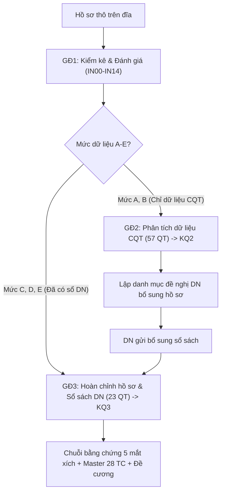

# Quy trình phân tích toàn diện hồ sơ kiểm tra thuế 3 giai đoạn (Chuẩn v1.2)

Căn cứ: Bộ biểu mẫu chuẩn v1.2 (`Bo_bieu_mau_chuan_phan_tich_ho_so_thue_v2.xlsx`, 32 sheets, 80 quy tắc rủi ro, 15 mẫu dữ liệu thô IN00–IN14), Bản đặc tả ứng dụng và Bộ prompt 3 giai đoạn tích hợp 13 quyết định cán bộ K1–K13 (Prompt P5 ngày 15/10/2026).

## 1. Nguyên lý cốt lõi: Giai đoạn là trạng thái dữ liệu

Giai đoạn phân tích được quyết định bởi **trạng thái nguồn dữ liệu hiện có** trên đĩa (xếp theo 5 mức A–E), không phải là thứ tự thời gian.
- **P1** chạy ở mọi lần tiếp nhận hồ sơ để kiểm kê và định vị mức dữ liệu.
- **P2** chạy khi chỉ có dữ liệu CQT (mức A, B), công ty chưa nộp sổ sách.
- **P3** chạy khi công ty đã gửi sổ sách kế toán (mức C, D, E), kể cả gửi thiếu một vài nội dung.
- **P4** chạy tăng dần khi NNT gửi thêm tài liệu bổ sung (xuất v+1, không ghi đè).
- **P5** báo cáo xác nhận hiểu 13 quyết định K1–K13 và đối chiếu pháp lý TT99, TMS.

---

## 2. Chi tiết 3 giai đoạn (Chuẩn v1.2)

### Giai đoạn 1: Kiểm kê hồ sơ & Đánh giá mức độ dữ liệu (KQ1)
- **Skill:** `giai-doan-1-kiem-ke-danh-gia`
- **Mục tiêu:** Quét toàn bộ thư mục hồ sơ (15 nguồn mẫu: IN00–IN14 gồm cả `IN14_TMS_Nghia_vu`), tính mã SHA-256 (bảo toàn nguồn gốc, không xóa file gốc), xác định định dạng (`Cau_truc`, `PDF-da-trich`, `PDF-chua-trich`).
- **Phân loại nguồn gốc theo K1:**
  - Cấp 1 `1. DU LIEU THO NGANH THUE` (gồm cả `1.3. Nghia vu nop thue & Thong bao` nạp vào IN14): Bản chuẩn CQT.
  - Cấp 1 `2. HO SO NNT CUNG CAP`: Bản do DN nộp.
- **Phân loại 5 mức hồ sơ:**
  - Mức A: Chỉ có dữ liệu CQT (HĐĐT, bảng kê, tờ khai XML, BCTC nộp CQT, CVCBRR, thông báo nợ thuế TMS).
  - Mức B: Mức A + BCTC/tờ khai do DN gửi riêng.
  - Mức C: Mức B + Sổ kế toán tổng hợp (IN08) và Sổ 511/632 (IN13).
  - Mức D: Mức C + Sổ kho (TK 152/155/156) và Bảng giá thành/định mức (IN09).
  - Mức E: Mức D + Sổ chi tiết tiền mặt (IN10) và Sao kê ngân hàng/UNC (IN11).
- **Rà soát 80 quy tắc:** Xác định trạng thái chạy được ngay / chạy một phần / bị chặn.
- **Đầu ra:** `KQ1_<MST>_<KY>_v1.xlsx` (3 sheet: `KQ1_Kiem_ke`, `KQ1_Kha_nang_phan_tich`, `KQ1_De_nghi_bo_sung` xếp theo số quy tắc được mở khóa).

### Giai đoạn 2: Phân tích bằng dữ liệu cơ quan thuế (KQ2)
- **Skill:** `giai-doan-2-phan-tich-du-lieu-co-quan-thue`
- **Mục tiêu:** Chạy khi công ty chưa gửi sổ sách.
- **Chuẩn hóa & Quyết định tích hợp:**
  - HĐĐT: gắn `Ky_hieu_HD`, `So_HD`, `MST_DoiTac_chuan`, cờ `Tinh_vao_tong` (loại HĐ hủy/thay thế; HĐ điều chỉnh giảm lưu số âm).
  - Bảng kê: lọc bỏ dòng `Tổng cộng` (giữ "TỔNG CÔNG TY"), chuẩn hóa MST (BT6).
  - Khóa đối chiếu tầng: Khớp đúng `Ky_hieu|So_HD|MST_chuan` → Khớp mờ theo ngày và giá trị.
  - **K2 (Nhóm F):** NCC rủi ro F0 và F1 đều xếp mức **Cao**. Nếu NNT đang kiểm tra thuộc F1 (bán ra cho F0), cờ rủi ro Cao được kích hoạt tại `HD01`.
  - **K5 (Ngưỡng tiền mặt):** Áp dụng dấu $\ge$ ở cả hai mốc: $\ge 20.000.000$ đ (đến 30/06/2025) và $\ge 5.000.000$ đ (từ 01/07/2025 theo Luật Thuế GTGT 48/2024/QH15).
  - **K10 (Nghĩa vụ nộp thuế):** `LS01`, `LS02` đọc từ `IN14_TMS_Nghia_vu`. Thiếu file ghi `KHÔNG_ĐỦ_DỮ_LIỆU`.
  - **K13 (Số liệu ngành):** Chưa có chỉ số ngành thì `HD07` chuyển trạng thái **TREO**; `TN03`, `TN04`, `TN19`, `TN22` gắn nhãn "sơ bộ – chưa so ngành".
- **Phạm vi 57 quy tắc:** DQ02–DQ08; GT01–GT05, GT07–GT15; TN01–TN03, TN05–TN16, TN19–TN22; HD01–HD09; TT01; LD01, LD03, LD04; LK01, LK02; LS01, LS02.
- **Phân loại kết luận:**
  - "Chắc chắn": quy tắc đối chiếu trực tiếp dữ liệu thuế (GT01–GT05, HD01–HD04, LD01, LD03, LD04...).
  - "Sơ bộ": quy tắc so BCTC (TN01, TN03, TN05–TN14, TT01...) vì cần sổ kế toán để chốt.
- **Đầu ra:** `KQ2_<MST>_<KY>_v1.xlsx` (7 sheet).

### Giai đoạn 3: Hoàn chỉnh hồ sơ khi có sổ sách doanh nghiệp (KQ3)
- **Skill:** `giai-doan-3-hoan-chinh-ho-so`
- **Mục tiêu:** Tích hợp nguồn DN (IN08–IN11, IN13) sau khi có KQ2.
- **Phạm vi 23 quy tắc chuyên sâu:** DQ01; GT06, GT16; TN04, TN17, TN18; TT02–TT06; KH01–KH07; DT01–DT03; LD02, LD05. Lọc quy tắc theo loại hình DN (Thương mại bỏ qua KH03, KH05, LD05).
- **Quyết định cán bộ bổ sung:**
  - **K3 (Master 28 TC):** Nếu hồ sơ đã dùng bộ mẫu đầy đủ, xuất 28 TC vào sheet `08_Master_28TC` (7 cột chuẩn).
  - **K4 (511-632):** Khóa ghép `Thang|Ma_san_pham_dich_vu` và cột xuất theo skill `doi-chieu-511-632`.
  - **K6 (Chỉ tiêu HTK BCTC):** B01-DN (TT200, TT99) dùng mã [141] = 152+155+156; B01-DNN (TT133) dùng mã ct140.
  - **K7 (Thông tư 99/2025/TT-BTC):** Hiệu lực 01/01/2026; thay thế TT200; TT133 vẫn tiếp tục áp dụng cho DNNVV. Mã số 319 (Doanh thu chờ phân bổ ngắn hạn), mã 411 (Vốn góp CSH). Chỉ tiêu vắng mặt trên BCTC là "doanh nghiệp không có số liệu", không phải lỗi thiếu nguồn.
  - **K11 (Chứng từ thiếu):** Thiếu sao kê/UNC/hợp đồng chỉ ghi nhận trạng thái thiếu bằng chứng tại mắt xích tương ứng (ghi "Không đủ dữ liệu"), không kết luận là hành vi vi phạm.
- **Nâng cấp kết luận GĐ2:** Các quy tắc đang ở nhãn "sơ bộ" được nâng thành "chắc chắn" hoặc "giải tỏa" rủi ro.
- **Chuỗi bằng chứng 5 mắt xích:** Hóa đơn hợp pháp → Hợp đồng/đơn hàng → Thanh toán qua NH → Nhập kho thực tế → Sử dụng/tiêu hao.
- **Đề cương kiểm tra tại trụ sở NNT:** Sắp xếp theo điểm, có cột Nhánh xử lý (Thủ tục / Thiếu thuế / Trốn thuế - do cán bộ chọn).
- **Đầu ra:** `KQ3_<MST>_<KY>_v1.xlsx` (9 sheet).

---

## 3. Khối Q: 13 Quyết định cán bộ tích hợp (K1–K13)

1. **K1 (Nguồn gốc thư mục):** Cấp 1 `1. DU LIEU THO NGANH THUE` = CQT; `2. HO SO NNT CUNG CAP` = DN.
2. **K2 (Mức rủi ro NCC):** F0 và F1 đều xếp mức **Cao**. CA coi là F0. NNT thuộc F1 là phát hiện Cao của `HD01`.
3. **K3 (Master 28 TC):** Không tự dựng thêm sheet rải rác; dùng sheet `08_Master_28TC` (7 cột).
4. **K4 (Khóa 511-632):** Khóa ghép và cột xuất theo chuẩn skill `doi-chieu-511-632`.
5. **K5 (Ngưỡng thanh toán tiền mặt):** Luôn dùng dấu $\ge$ ở cả hai mốc ($\ge 20$ triệu trước 01/07/2025; $\ge 5$ triệu từ 01/07/2025).
6. **K6 (Chỉ tiêu HTK BCTC):** B01-DN (TT200, TT99) dùng [141]; B01-DNN (TT133) dùng ct140.
7. **K7 (BCTC Thông tư 99):** Thay TT200 từ 01/01/2026; TT133 vẫn có hiệu lực; mã 319 cho Doanh thu chờ phân bổ, mã 411 cho Vốn góp CSH. Chỉ tiêu vắng mặt = không có số liệu.
8. **K8 (Mốc trọng yếu B01):** Cán bộ chỉ định $\rightarrow$ Skill AI gợi ý $\rightarrow$ Mặc định sheet 05.
9. **K9 (Thuế suất GTGT giảm):** Căn cứ NQ 142/2024, NQ 174/2024, NQ 204/2025.
10. **K10 (Nghĩa vụ thuế TMS IN14):** `LS01`, `LS02` đọc từ `IN14_TMS_Nghia_vu`. Thiếu ghi `KHÔNG_ĐỦ_DỮ_LIỆU`.
11. **K11 (Chứng từ thiếu):** Ghi "Không đủ dữ liệu" vào mắt xích chuỗi bằng chứng, cấm quy chụp vi phạm.
12. **K12 (Kỳ kiểm tra thuế):** Cán bộ chỉ định theo quyết định kiểm tra tại ô tham số sheet 00.
13. **K13 (Chỉ số ngành):** Chưa có chỉ số ngành thì `HD07` ghi **TREO**; `TN03`, `TN04`, `TN19`, `TN22` ghi nhãn "sơ bộ – chưa so ngành".

